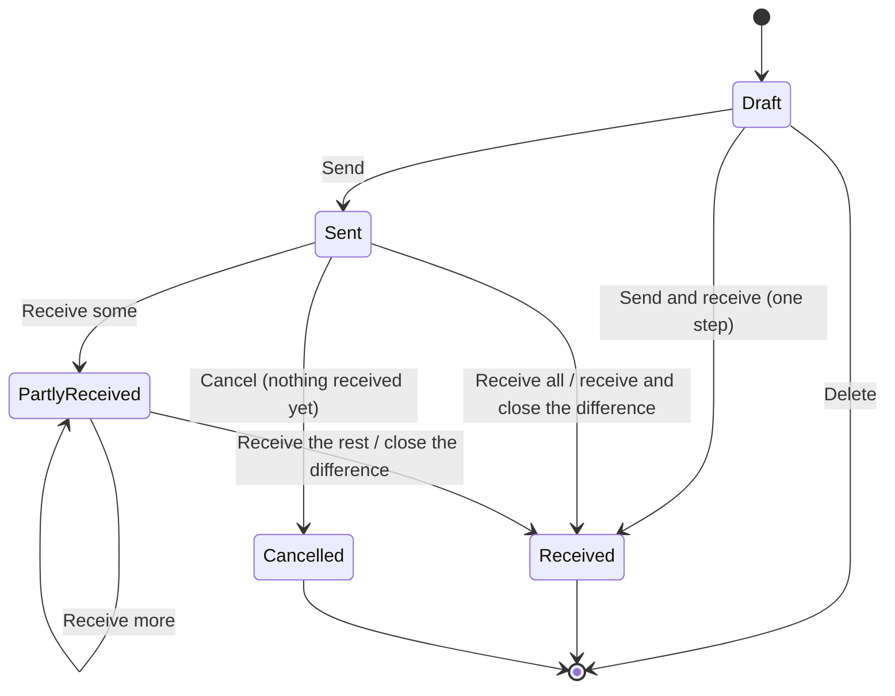

# Inventory phase 2 — research: transfers between sites, and placement

Phase 1 of **Inventory** (nb **Lager**) is on main: sites and their location trees, the
ledger of adjustments, moves, receipts and counts, packagings, labels, the opening-balance
import, and — with Orders' delivery C — reservations per site and the `issue` kind. Two
items of the design's *Later* list (spec §11) wait for nothing any more:

1. **Transfers between sites** — stock sent from one site, in transit, received at another.
2. **Placement** — where a variant belongs at a site (its primary location), its minimum
   and maximum, and a **low-stock list**.

This note settles what phase 2 is, from what the products a Norwegian small business
compares against do (the owner, 2026-11-08: *do not stray far from what our competitors
do*) and from the code as it stands. It sketches how the screens could look and behave
(§6, §7). A design spec starts from §9 and does not reopen it.

Code references are against `main` at `4dcc14cd3`; `srv/` abbreviates
`apps/server/internal/`, `mig/` `srv/db/migrations/`, `ui/` `apps/inventory/frontend/src/`.
The phase 1 research is *N* (`research/2026-10-27-inventory-module.md`), the phase 1 design
*D* (`specs/2026-10-27-inventory-design.md`), the Orders design *O*
(`specs/2026-11-05-orders-design.md`).

## 1. What is decided, and what this note adds

### 1.1 On the record

- **2026-10-27, the owner (N §9.1):**
  - reading 5 — *no moves between sites until the two-step transfer arrives*; an instant
    one "would be very weird";
  - reading 10 — *placement and min/max later*, not in phase 1.
- **2026-11-07, the owner:** phase 2 is transfers plus placement; the ledger keeps a
  poster's name after erasure; labels print with `locations-view`.
- **2026-11-08, the owner:** stay close to what competitors do; sketch the screens.
- **D §12** kept for this phase: the source reference on every movement; the kinds as an
  open set; lines with no *from* or no *to*; balances as rows; reservations per site, not
  a column.

### 1.2 One conflict between the documents

ROADMAP.md:882 and D I13 (:156) say transfers *wait for Orders*; O §13 (:1501) hands them
to *the purchasing app*. Neither is right any more: Orders turned out to be sales only, and
a transfer moves the tenant's own goods between its own sites — nothing is sold and
nothing bought. **This note proposes that Inventory owns transfers** (§9.1 reading 1); the
spec corrects the roadmap, and O §13 stays as written (specs are records).

### 1.3 What this note settles

- the shape of a transfer: its states, what happens to stock at each step, partial
  receipt and differences, cancelling (§3, §6);
- how it fits the ledger without breaking the one-site rule (§5);
- placement: primary location, reorder point and maximum, per variant **per site** (§4,
  §7);
- the low-stock list and what it can do before a Purchasing app exists (§4.4, §7.3);
- the Norwegian words (§8);
- the readings the owner answers (§9).

## 2. What the products do

Four lanes of research: the ERPs (Odoo 17/18, Business Central, ERPNext, NetSuite), retail
and small-business tools (Shopify, Lightspeed X and R, Square, Zoho Inventory, Katana, Cin7
Core), and the Nordic field (Tripletex with Rackbeat, Visma.net ERP, Visma Business NXT,
PowerOffice Go, Fortnox). Several help centres refused direct fetches (Tripletex,
Lightspeed X, the Visma community); claims resting on search summaries are marked *(s)*.

### 2.1 Transfers

| Product | Steps | Stock leaves source | In transit is | Partial receipt | Short / damaged | Cancel after send |
| --- | --- | --- | --- | --- | --- | --- |
| **Odoo** | 1 (internal transfer) or 2 (resupply route: a delivery + a receipt) | on validating the delivery | a *transit* location, `Inter-warehouse transit` | yes, with a backorder (*Ask / Always / Never*) | none; "No backorder" leaves the rest in transit | no; a *Return* reverses |
| **Business Central** | Transfer order: *ship* then *receive*; or *Direct transfer* | on *Post ship* | an in-transit location named on the order | yes, *Qty. to ship / to receive* | none | *Undo shipment* while not received |
| **ERPNext** | Material Transfer; *Add to transit* makes it 2 | on submit of the outgoing entry | a warehouse of type *Transit* | yes, `per_transferred` | none | cancel and amend |
| **NetSuite** | Transfer order: fulfil, then receive | on the fulfilment | a quantity, and an *in transit* account | restricted | none | — |
| **Shopify** | Draft → *Ready to ship* (committed) → *In transit* → *Transferred*; or *Mark as transferred* at once | on *Move to in transit* | **Incoming** at the destination | yes, stays *In progress* | per unit: **Accept / Reject** (logged, out of stock) **/ Cancel** (back to origin) | only before sending |
| **Lightspeed X** | Open → *Mark as sent* → *Receive* | on send | **Incoming** at the destination | — *(s)* | **the difference returns to the source** *(s)* | while incoming *(s)* |
| **Square** | Transfer order: draft → started → (partially) received; or *Transfer instantly* | on start | nowhere visible | yes | edit quantities | yes; unreceived returns to source *(s)* |
| **Zoho Inventory** | *Initiate transfer* → In transit → *Mark as received*; or *Transfer and receive* | on initiate | — | not documented | — | delete only |
| **Katana** | Created (reserved) → In transit → Received | on in transit | — | not documented | — | *Revert* one step |
| **Tripletex** | **one step**: a *lagerkorreksjon* row with *fra* and *til* warehouse and location | at once | — | — | — | — |
| **Rackbeat** (Tripletex *Logistikk Komplett*) | *Lagerflytning* (instant) or *transport transfer* (send → receipt at the destination) | on send | a *transport* location | yes, edit delivered quantities | — | — |
| **Visma.net ERP** | Transfer: **1-step or 2-step** per document; or a transfer order (TR) | on release / *update inventory* | a hidden in-transit warehouse | yes, a receipt may take part of the lines | reason code per line | — |

Every two-step product works the same way: a **document** with a number, the *from* and
*to* site, a date, an optional reference or note and lines; stock **leaves the source when
it is sent, not when the document is saved**; in transit it is **available at neither
site**; the destination **receives by entering a quantity per line**, defaulting to what
was sent; once sent, the sites and lines are locked. Most of them also offer the one-step
shortcut (*Mark as transferred*, *Transfer instantly*, *Transfer and receive*, Visma.net's
1-step), and the most-used Norwegian tool, Tripletex Basis, offers only that.

What they handle badly is the **difference**: Odoo, Business Central and ERPNext leave an
unreceived quantity sitting in transit until someone writes it off by hand — the most
common way transit stock goes wrong. Shopify makes the receiver say what happened to every
unit; Lightspeed sends the difference home.

UX worth copying: **the source's and the destination's stock beside each line** while the
transfer is drafted (Zoho, Katana, Shopify's *Move* preview); **scan to add** (+1 per scan)
and **Accept all** when receiving; **a printable transfer note** (Square's *Save as PDF*,
Zoho's print) — a shop sending a box to another shop puts a paper in it; **filters by
status, origin and destination** on the list.

### 2.2 Placement and replenishment

| Product | Default location | Levels, per | Rule | Low-stock list and its actions |
| --- | --- | --- | --- | --- |
| **Odoo** | putaway rules (product/category → location) | reordering rule: **Min, Max, Multiple**, per product × location | *forecast* < Min → order up to Max | *Replenishment*: On hand, Forecast, Min, Max, **To order**; *Order once*, *Automate*, *Snooze*; shows **other warehouses' stock** and can make a transfer |
| **Business Central** | *Default* bin per item per location | stockkeeping unit: reorder point, max, policy, **replenishment = transfer from X** | projected ≤ reorder point | requisition worksheet → purchase or **transfer orders** (planner-grade) |
| **ERPNext** | item default warehouse | Item Reorder: level, qty, **type = transfer** | projected ≤ level | none; a daily material request by email |
| **Lightspeed X / R** | free-text aisle/bay/shelf per outlet | **reorder point + reorder qty** (or min/max, 2026) per variant **per outlet** | ≤ reorder point; *need* = desired − (on hand + incoming transfers + on order) | low-stock report; *Autofill from reorder point* on a PO **or a transfer** |
| **Square** | — | one *low stock alert* per item per location | ≤ alert | yellow dot; a daily email per location; row menu *add to PO / to transfer* |
| **Zoho Inventory** | — | reorder level + **max**, min/max order qty, multiple, **source = vendor or location**, per item per location | ≤ level | *Pending replenishments*: **Create purchase order / Create transfer order / Dismiss** |
| **Katana** | **default storage bin** per variant per location | safety stock per variant per location | in stock − committed + expected − safety < 0 | a daily bell with quick buttons |
| **Shopify** | — | **none** | — | none (apps) |
| **Tripletex** | **Hovedlokasjon** — the first location added to a product | a minimum, per product | below minimum | a product-list filter → a purchase dialog |
| **Visma.net** | default issue and receipt location per item per warehouse | reorder point, max, safety stock per item per warehouse | ≤ reorder point | *Prepare replenishment* → **purchase orders or transfer orders** by the item's source |
| **Business NXT** | prioritised item locations | min, max, **point of purchase** per product per warehouse | ≤ point of purchase | purchase estimates |
| **Fortnox** | default *lagerställe* and *lagerplats* per item | **Beställningspunkt, Max-lager** per article **per lagerställe** | *disponibelt* ≤ beställningspunkt | the stock list's *Lågt saldo* filter → a purchase |

The common ground: **one level per variant per site** (all but Shopify), usually with a
second number — a maximum or target (Odoo, Lightspeed R, Zoho, Visma, Fortnox) or a fixed
reorder quantity (Lightspeed X, Business Central's other policy); a **default location**
per variant per site (Tripletex, Fortnox, Visma.net, Katana, Business Central), used to
suggest where received goods go; the rule measured against **what is available plus what
is coming**, not on hand — measuring on hand alone orders twice when a transfer is already
on the way. The low-stock list ends in **a purchase order** everywhere, and in **a
transfer from another site** in Odoo, Business Central, Visma.net, Zoho, Lightspeed and
Square. Alerts are **periodic**, not real time (Square's daily email, Katana's daily bell,
Zoho's scheduled check).

### 2.3 What a Norwegian small business expects

Tripletex Basis is the floor: several warehouses, one location level, a one-step move, a
*Hovedlokasjon*, a minimum and a below-minimum filter. Rackbeat and Visma.net are the step
up: a two-step transfer with a transit place and a partial receipt, a reorder point and a
maximum per warehouse, and — Visma.net only — a suggestion that proposes a transfer
instead of a purchase. Shopify, which many web shops run, has transfers but no reorder
level at all.

## 3. Transfers — what phase 2 builds

### 3.1 The document

A **transfer** (nb *lageroverføring*) is Inventory's own document, numbered per tenant
(`T-1001`), with:

- **from site** and **to site** — two active sites, different;
- an optional **reference** and **note** (free text), and an **expected arrival** date;
- **lines**: a variant and a quantity — entered in packagings as any line (D §2), resolved
  to units and snapshotted when sent, so a packaging changed in transit changes nothing;
  the receiver enters units, or packagings as they are on the day — and, once
  sent, the **location it left** at the source; on receipt, the **location it arrived
  at** at the destination;
- who created, sent and received it, and when (the ledger's poster snapshot, D rule 19).

### 3.2 States



| State | nb | Stock | What can change |
| --- | --- | --- | --- |
| **Draft** | *Utkast* | nothing; a draft reserves nothing (§9.1 reading 4) | everything; a draft can be deleted |
| **Sent** — *in transit* | *Sendt — under transport* | has left the source locations; at neither site; shown as **incoming** at the destination | the note and expected arrival only |
| **Partly received** | *Delvis mottatt* | what arrived is at the destination; the rest is still in transit | — |
| **Received** | *Mottatt* | everything accounted for: received, or closed as missing | nothing; a mistake is a new transfer back |
| **Cancelled** | *Avbrutt* | sent and nothing received: the stock goes back to the locations it left | nothing |

### 3.3 Receiving and the difference

The receiver accounts for **every unit that was sent** (§2.1's lesson). Per line, the
receive screen (§6.4) asks *how many arrived now*, defaulting to what is still outstanding,
and a destination location, defaulting to the variant's primary location at that site
(§4.1), else the site itself. Receiving less leaves the transfer **partly received**; the
rest stays in transit and the transfer stays on the destination's *incoming* list. When the
receiver knows the rest will not come, **Close the difference** records it per line as
**missing**, with one reason for the closing — *lost in transit*, *damaged*, *never
packed* or *other* — and an optional text, and the transfer is received. Missing stock is
not put back anywhere: it left the source when it was sent, so closing writes nothing to
the balances. The record stays on the transfer and in the transfer's events, and the
variant's history shows *2 missing on T-1043 (damaged)* beside its movements, so shrinkage
by reason is as visible as an adjustment's — Shopify logs its *Reject* the same way.

*Received more than was sent* is refused; the extra is a receipt or an adjustment at the
destination. Business Central refuses it; Odoo accepts more than the demand with a warning
*(s)* — refusing keeps the transfer's arithmetic closed.

### 3.4 Sending

**Send** picks a source location per line (the line editor's location picker, defaulting
to the variant's primary location at the source, else the location holding most), checks
each like a move — on hand at that location — and posts the stock out. Movements are not
blocked while counting (D I17): a send out of a counted location, or a receive into one,
flags those count lines *moved* (D I19), and the count then needs *accept moved* to post,
as any move does today. It does **not** refuse a send that eats into what Orders has reserved at the
source: on hand never goes below zero, and *available* may already go negative (O, the
Stock card turns red). It **warns** before sending, naming the orders' reserved quantity
(§9.1 reading 5).

**Send and receive** is the one-step shortcut most products offer and Tripletex's only
move: the same document, sent and received in one confirmation, recorded as the same two
steps (§5) so the history reads the same. It is offered on the draft; the owner decides
whether it exists at all (§9.1 reading 2), since reading 5 of N §9.1 called an *instant*
move weird — this is the two-step document, done at once.

### 3.5 Cancelling

A draft is **deleted**. A sent transfer with **nothing received** can be **cancelled**:
its stock goes back to the locations it left (Business Central's *Undo shipment*,
Shopify's *Cancel*, Square). Those locations cannot have been archived meanwhile (§5); a
location deleted since cannot exist, since a location that ever held stock is never
deleted (D §2). Once something has arrived, the transfer can only be
received or closed; a mistake is a new transfer back.

### 3.6 The transfer note

**Print transfer note** (nb *følgeseddel*, §9.1 reading 14) makes a one-page PDF: number, from and to
site, sent date, expected arrival, the lines with SKU, name, quantity and the source
location, a barcode of the transfer's number, and a signature line for the receiver. The
receive screen's scan field accepts that barcode and opens the transfer (Shopify scans a
shipment barcode the same way). It reuses the labels' PDF machinery (`srv/inventory/labels.go`,
`fonts/`).

### 3.7 Who may do it

One new key, **`inventory:transfers-manage`** — create, send, receive, cancel — taken with
both views as every write (`srv/inventory/module.go`:20-24). No product researched splits
sending and receiving into different permissions for a small business, and Vantigo has no
per-site permission; who sent and who received is recorded (§9.1 reading 6). Seeing
transfers needs the two views alone.

## 4. Placement — what phase 2 builds

### 4.1 The placement row

N §4.4 named it: *where an item belongs* and *how many lie there* are different facts. A
**placement** is one row per **variant × site**, kept apart from the balances (D §12.4):

- **primary location** (nb *hovedlokasjon*, Tripletex's word) — an active location in that
  site, or none;
- **reorder point** (nb *bestillingspunkt*) — a quantity, or none;
- **maximum** (nb *maksbeholdning*) — a quantity, or none, not below the reorder point.

A row with nothing set is no row. Per *site*, not per location: every product researched
keeps the level per warehouse or outlet; a shelf-level minimum (NetSuite's bin
replenishment) is later.

### 4.2 What the primary location does

It is the **suggestion**, never a rule: the default *to* location of a receipt line, of a
transfer received at that site, and the default *from* location of a transfer sent from
it; the first location in the variant's stock rows; a pin on the location's contents. Putting
it first in Orders' pick list too (`deliveryLocations`, `srv/orders/deliveries.go`:222-237,
read through `contracts.Stock.Locations`, which answers the locations holding stock by
full code) needs a `primary` flag on `contracts.StockLocation` — a contract change B makes,
and Orders sorts by it.
It is set by hand — Tripletex's *first added becomes primary* and Business Central's *first
put-away* both surprise people. Archiving or deleting the location clears it, with an event.

### 4.3 The rule

```
available   = on hand at the site − reserved at the site      (as today, srv/inventory/ledger.go:118-178)
incoming    = sent to the site, not yet received or closed    (§3)
projected   = available + incoming
low         = reorder point is set and projected ≤ reorder point
suggested   = (maximum, or the reorder point when there is none) − projected, at least 1 for a low row
```

`≤` as Lightspeed, Square, Visma.net and Fortnox (Odoo uses `<`). Projected, not on hand,
so a transfer already on the way does not ask for the same goods twice — the pitfall every
ERP lane named. *At least 1*: without a maximum, a row exactly at its reorder point is low
and must suggest something. Rounding the suggestion up to whole packagings — a shop buys
coffee in boxes of 15 — is a reading (§9.1 reading 13); without it, the suggestion is
shown with its breakdown into packagings as every quantity is (D §2). When a Purchasing app arrives, its
open purchase orders join *incoming*.

### 4.4 The low-stock list

A page **Low stock** (nb *Lav beholdning*) in the sidebar, filtered by site, listing every
variant whose placement is low (§7.3). What it can do before Purchasing exists:

- **Create transfer** — select rows at one site and start a draft transfer *to* it, with
  the suggested quantities; the source is the site with most available, and each line
  shows what every other site has (Odoo's *Warehouses* tab, Zoho, Lightspeed's *Autofill
  from reorder point*);
- **Export CSV** — the list as a file to order from a supplier by mail, the step Tripletex
  and Fortnox users take with a purchase dialog today: site, SKU, name, barcode, available,
  incoming, reorder point, maximum, suggested, and the suggestion in the variant's largest
  packaging that fits. There is no supplier column: suppliers are free text on receipts
  (N §9.1 reading 11) until Products phase 5;
- a link to the variant.

No *snooze*, *dismiss* or *automate* in v1 — they belong with automatic ordering, which
waits for Purchasing (§9.1 reading 8).

### 4.5 Where it is set

- the **variant's stock page**: a placement row per site, edited in place (§7.1);
- the **Stock card** on the product page shows the levels and marks a low site (§7.2);
- **in bulk**: a second import, *Placements*, beside the opening-balance import — one row
  per SKU × site with primary location code, reorder point and maximum (Katana and
  Lightspeed import the same row) (§9.1 reading 9);

and it needs `stock-adjust` with both views (§9.1 reading 7).

### 4.6 Telling people

The dashboard's attention list (`srv/inventory/stats.go`:55-74, today one item, counts open
too long) gains two items: **N items below their reorder point at {site}**, linking to the
list, for whoever holds both views; and **a transfer still open** — past its expected
arrival, or with no expected arrival and sent or partly received more than 7 days ago — for
whoever holds `transfers-manage`, so nothing lies in transit forgotten. Today the endpoint
answers nothing at all without `counts-manage` (`stats.go`:56); the gate moves to each
item. A daily mail to the people who hold `stock-adjust` is possible
(a worker and `module.Deps.Mail`, `srv/module/module.go`:38) but no other module mails a
summary, and the research shows a dashboard bell is what small tools rely on; it is a
reading (§9.1 reading 10).

## 5. How it fits the ledger

The ledger posts **one movement per site** (`srv/inventory/posting.go`:84, the header's one
`siteID`) and refuses a line in another site (`posting.go`:288-289, `move_crosses_sites`).
A transfer keeps that rule rather than bending it:

- **Send** posts at the **source** a movement of the new kind **`transfer_out`**, whose
  lines have a *from* and **no *to*** (D §12.3 kept it possible);
- **Receive** posts at the **destination** a movement of the new kind **`transfer_in`**,
  whose lines have **no *from*** and a *to*;
- **Cancel** posts at the source a `transfer_in` back to the locations it left;
- both carry the transfer as their **source reference** (`source_module = inventory`,
  `source_kind = transfer`, `source_id`; `mig/00108_inventory_baseline.sql`:85-96), as
  Orders' `issue` does — which changes a documented rule: `source` is today *nil for the
  module's own postings* (`posting.go`:94-95), and becomes Inventory's own reference for a
  transfer's;
- **idempotency:** *send* derives its key from the transfer, as `Issue` does
  (`ledger.go`:550) — one send per transfer. A transfer is received in several parts and
  may be cancelled, so a key per document would make the second receipt a replay; **receive
  and cancel take a client request id** per request, as every posting does (D I14), since a
  scanner retries;
- **lock order:** the transfer row `FOR UPDATE` first, then the engine's own order
  (variants, the movement claim, locations, balances; `posting.go`:31-54), so a receive and
  a cancel of one transfer serialise and the second sees the first's result;
- **in transit is no balance and no location**: it is *sent − received − closed* on the
  transfer's lines. Odoo, Business Central and ERPNext model a transit location, and each
  of them leaves orphan stock there (§2.1); a quantity on the document cannot be orphaned,
  because the document is the only place it lives and it shows until received or closed.
  This departs from every product researched, the Norwegian step-up products included —
  Rackbeat suggests a *transport* location, Visma.net keeps a hidden in-transit warehouse —
  but what the user sees is the same: *in transit* on the transfer, *incoming* at the
  destination.

| Step | Source site balances | In transit (on the transfer) | Destination site balances | Ledger |
| --- | --- | --- | --- | --- |
| Draft, 10 | 10 on A-01 | — | 0 | — |
| Send 10 from A-01 | **0** | **10** | 0 | `transfer_out` at the source |
| Receive 7 to B-03 | 0 | **3** | **7** on B-03 | `transfer_in` at the destination |
| Close the difference, 3 missing | 0 | **0** (3 missing) | 7 | — (recorded on the transfer) |
| *or* Cancel (before any receipt) | 10 on A-01 | 0 | 0 | `transfer_in` at the source |

What else reads it: the **product's** and **variant's stock** gain *in transit* per
destination site (the Stock card, §7.2); the **stock totals** for the product list's *On
hand* column stay on-hand only (a parcel on the road is not on a shelf), with *in transit*
beside them; `contracts.Stock.Available` stays on hand − reserved — Orders cannot reserve
stock on the road. A **count** sees sent stock gone from its location and received stock
arrived, and flags the lines *moved* (§3.4).

The **holder** (`VariantReferenceHolder`, D I23) knows the kinds `stock`, `reserved` and
`open_documents` (`srv/contracts/references.go`:96-98). A variant in transit is held under
a new kind, **`in_transit`**, for both purposes — delete and the change to Service — which
is a contract change, and Products' refusal message gains its text. A **draft** holds
nothing: a draft line whose variant is deleted or becomes a service is refused when sent
(`LockVariants` reads it), and the draft shows the line as gone.

**Archiving** a site or a location is refused today only while stock lies there
(`srv/inventory/sites.go`:20-21) — and stock in transit is no balance. So archiving is also
refused while the site is the *from* or *to* of an open transfer, and while a location is
the source of a line still in transit (the cancel's way home); otherwise the destination
could be archived with goods on the road and nothing could ever be received.

**Disabling Inventory** with a transfer in transit freezes it: nothing can be received
until the module is on again, and the holder keeps the variants held (it runs when the
module is off, D §8). That is accepted, and the *Enabling and disabling* section says so.

Inventory publishes no outbox events today (`srv/inventory/module.go`:71-82). Nothing
needs `inventory.transfer.sent` or `.received` yet; the spec adds them only if a consumer
appears (§9.1 reading 11).

## 6. Sketches — transfers

The screens follow the app's patterns (`ui/pages/movements.tsx`, `ui/components/movement-form.tsx`,
`ui/components/line-editor.tsx`): a list page, a form page with the shared line editor, and
a detail page. Sketches in English; nb words in §8.

### 6.1 The transfers list

Sidebar: Overview · **Transfers** · Movements · Receipts · Counts · **Low stock** · Import.

```
Transfers                                                     [ New transfer ]
┌───────────────────────────────────────────────────────────────────────────┐
│ Status [ Open ▾ ]  From [ Any site ▾ ]  To [ Any site ▾ ]  🔍 number, SKU  │
├────────┬──────────────┬──────────────┬─────────────────┬──────┬───────────┤
│ No.    │ From         │ To           │ Status          │ Lines│ Expected  │
├────────┼──────────────┼──────────────┼─────────────────┼──────┼───────────┤
│ T-1042 │ Main warehouse│ Oslo store  │ ● In transit    │ 12   │ 10 Nov    │
│ T-1041 │ Main warehouse│ Bergen store│ ◐ Partly received│ 4   │ 7 Nov  ⚠ │
│ T-1040 │ Oslo store   │ Main warehouse│ ○ Draft       │ 2    │ —         │
│ T-1039 │ Bergen store │ Oslo store   │ ✓ Received     │ 6    │ 3 Nov     │
└────────┴──────────────┴──────────────┴─────────────────┴──────┴───────────┘
  ⚠ = past its expected arrival and not received
```

*Open* means draft, in transit or partly received. A site's page gains a small **Incoming**
panel (transfers in transit to it) and an **Outgoing** one, each linking here filtered.

### 6.2 A new transfer (draft)

```
New transfer                                                      T-1043 · Draft
┌───────────────────────────────────────────────────────────────────────────┐
│ From  [ Main warehouse ▾ ]      To  [ Oslo store ▾ ]                       │
│ Expected arrival [ 12.11.2026 ]  Reference [ Weekly restock     ]          │
│ Note  [                                                          ]         │
├───────────────────────────────────────────────────────────────────────────┤
│ Scan or search an item  [ ▌                                     ]          │
├──────────────────────────────┬───────────┬──────────────┬─────────────────┤
│ Item                          │ Quantity  │ At Main wh.  │ At Oslo store   │
│                               │           │ avail.       │ avail. · reorder│
├──────────────────────────────┼───────────┼──────────────┼─────────────────┤
│ Coffee beans 1 kg · CB-1000   │ [ 2 ▾ box ] = 30 │ 140   │ 4 · ≤ 10   low  │
│ Filter papers · FP-102        │ [ 50     ] │ 12   ⚠ short│ 0 · ≤ 20   low  │
│ Mug, white · MG-01            │ [ 6      ] │ 40          │ 9 · —           │
└──────────────────────────────┴───────────┴──────────────┴─────────────────┘
  [ Save draft ]   [ Send… ]   [ Send and receive… ]           [ Delete draft ]
```

The two stock columns are the research's most-copied pattern (Zoho, Katana, Shopify). A
line asking for more than the source has shows a warning on the draft and is refused only
when sending.

### 6.3 Sending

```
Send T-1043 to Oslo store                                              ✕
  Pick each line from a location at Main warehouse.
  ┌─────────────────────────────┬────────┬──────────────────────────────┐
  │ Coffee beans 1 kg · CB-1000 │ 30     │ [ A-01-03 (primary) · 112 ▾ ]│
  │ Filter papers · FP-102      │ 12     │ [ B-02-01 · 12 ▾ ]           │
  │ Mug, white · MG-01          │ 6      │ [ A-04-02 (primary) · 40 ▾ ] │
  └─────────────────────────────┴────────┴──────────────────────────────┘
  ⓘ 5 of the coffee beans are reserved for orders at Main warehouse;
    sending leaves them short.
  [x] Print the transfer note
                                        [ Cancel ]   [ Send 3 lines ]
```

The filter papers' 50 of the draft were lowered to the 12 Main warehouse has before
sending; sending more than the location holds is refused. After sending: the transfer is
*In transit*; the stock is gone from the source locations,
shown as **incoming** at Oslo store; the transfer note opens if ticked.

### 6.4 Receiving

```
Receive T-1043 from Main warehouse                     Sent 8 Nov by Kari N.
  Scan an item or the transfer note  [ ▌             ]        [ Accept all ]
  ┌─────────────────────────────┬──────┬───────────┬──────────┬───────────────────┐
  │ Item                        │ Sent │ Received  │ Now      │ To location       │
  │                             │      │ before    │          │ at Oslo store     │
  ├─────────────────────────────┼──────┼───────────┼──────────┼───────────────────┤
  │ Coffee beans 1 kg · CB-1000 │ 30   │ 0         │ [ 30 ]   │ [ Back room ▾ ]   │
  │ Filter papers · FP-102      │ 12   │ 0         │ [ 10 ]   │ [ Shelf 4 (primary)]│
  │ Mug, white · MG-01          │ 6    │ 0         │ [ 6  ]   │ [ Shelf 2 (primary)]│
  └─────────────────────────────┴──────┴───────────┴──────────┴───────────────────┘
  2 filter papers will still be in transit.
                         [ Back ]  [ Receive 46 ]  [ Receive and close the difference… ]
```

*Receive and close the difference…* asks once for what happened to the rest:

```
Close the difference                                                   ✕
  Filter papers · FP-102    2 not received
  What happened?  ( ) Lost in transit  (•) Damaged  ( ) Never packed  ( ) Other
  Note (optional) [ Box arrived opened                               ]
  They will be recorded as missing on T-1043 and not added to any stock.
                                          [ Back ]   [ Close T-1043 ]
```

### 6.5 The transfer page

```
T-1043  Main warehouse → Oslo store                     ◐ Partly received
Reference Weekly restock · Expected 12 Nov · Note —
┌─────────────────────────────┬──────┬──────────┬─────────┬─────────┐
│ Item                        │ Sent │ Received │ Missing │ In transit│
├─────────────────────────────┼──────┼──────────┼─────────┼─────────┤
│ Coffee beans 1 kg · CB-1000 │ 30   │ 30       │ —       │ —       │
│ Filter papers · FP-102      │ 12   │ 10       │ —       │ 2       │
│ Mug, white · MG-01          │ 6    │ 6        │ —       │ —       │
└─────────────────────────────┴──────┴──────────┴─────────┴─────────┘
History
  8 Nov 14:02  Sent by Kari N. from Main warehouse          → movement M-5531
  9 Nov 09:15  46 received by Ola H. at Oslo store          → movement M-5540
[ Receive… ]  [ Print transfer note ]
```

The two movements appear in the movements list as *Transfer out* and *Transfer in*, each
linking back to the transfer.

## 7. Sketches — placement

### 7.1 The variant's stock page, with its placements

```
Coffee beans 1 kg · CB-1000                                 Stock and movements
┌──────────────┬─────────┬──────────┬───────────┬────────────┬───────────┬───────┐
│ Site         │ On hand │ Reserved │ Available │ In transit │ Reorder pt│ Max   │
├──────────────┼─────────┼──────────┼───────────┼────────────┼───────────┼───────┤
│ Main warehouse│ 110    │ 5        │ 105       │ —          │ 40        │ 200   │
│   primary A-01-03 · 82, B-02-01 · 28                                            │
│ Oslo store   │ 4       │ 0        │ 4         │ +30 incoming│ 10        │ 40    │
│   primary Back room · 4                                                         │
│ Bergen store │ 12      │ 2        │ 10        │ —          │ —         │ —     │
└──────────────┴─────────┴──────────┴───────────┴────────────┴───────────┴───────┘
  [ Edit placement ] on a row opens:

  Placement at Oslo store                                              ✕
    Primary location  [ Back room ▾ ]
    Reorder point     [ 10 ]   Low when available + incoming is at or below it.
    Maximum           [ 40 ]   The suggestion fills up to it.
                                                  [ Remove ]  [ Save ]
```

Oslo store is **not** low: 4 available + 30 incoming = 34, above its reorder point of
10. Before T-1043 was sent it was (4 ≤ 10), and it sat on the low-stock list; sending the
transfer took it off — the rule of §4.3 at work.

### 7.2 The Stock card on the product page

```
Stock                                            On hand 126 · In transit 30
  Main warehouse   110   reserved 5 · available 105
  Oslo store         4   + 30 incoming            reorder ≤ 10
  Bergen store      12   reserved 2 · available 10
  [ See every location ]
```

### 7.3 The low-stock list

```
Low stock                                                    [ Export CSV ]
┌──────────────────────────────────────────────────────────────────────────┐
│ Site [ Oslo store ▾ ]                              🔍 SKU or name          │
├───┬──────────────────────────┬────────┬────────┬────────┬──────┬────┬─────┤
│ ☐ │ Item                     │ Avail. │Incoming│Reorder │ Max  │Sug.│ Elsewhere   │
├───┼──────────────────────────┼────────┼────────┼────────┼──────┼────┼─────┤
│ ☑ │ Filter papers · FP-102   │ 0      │ 2      │ 20     │ 60   │ 58 │ Main 0 · Bergen 14 │
│ ☑ │ Tea, green · TG-20       │ 3      │ —      │ 5      │ 24   │ 21 │ Main 80     │
│ ☐ │ Grinder burr · GB-7      │ 0      │ —      │ 1      │ —    │ 1  │ —           │
└───┴──────────────────────────┴────────┴────────┴────────┴──────┴────┴─────┘
  2 selected  [ Create transfer to Oslo store from [ Main warehouse ▾ ] ]
```

*Create transfer* opens §6.2 as a draft with those lines and the suggested quantities,
capped by what the chosen source has. *Elsewhere* is each other site's available
quantity.

### 7.4 The dashboard

```
Needs attention
  ⚠ 3 items below their reorder point at Oslo store          → Low stock
  ⚠ T-1041 to Bergen store is 1 day past its expected arrival → Transfer
  ⚠ The count of Main warehouse, zone A has been open 9 days  → Count   (today's item)
```

## 8. Words

The app's Norwegian is already the trade's (`ui/i18n.ts`:5 names *Lager*, *lagersted*,
*lokasjon*, *beholdning*; *reservert* and *disponibelt* are at :597-599; a cancelled count
is *Avbrutt*, :738). The
new words, from what the competitors show:

| English | nb | Seen in |
| --- | --- | --- |
| Transfer | **Lageroverføring** (short *Overføring*) | Visma.net (nb), Rackbeat *Lagerflytning* |
| Transfers (sidebar) | **Overføringer** | — |
| From site / To site | **Fra lagersted / Til lagersted** | Tripletex *fra … til*, Visma.net |
| Draft / Sent / In transit | **Utkast / Sendt / Under transport** | Rackbeat *transport*; Visma.net *in transit* |
| Partly received / Received | **Delvis mottatt / Mottatt** | Tripletex *varemottak* |
| Cancelled | **Avbrutt** | the app's counts |
| Send / Receive / Send and receive | **Send / Motta / Send og motta** | — |
| Incoming | **Innkommende** | Shopify *Incoming* |
| Close the difference / Missing | **Avslutt med avvik / Ikke mottatt** | the trade's *avvik* |
| Transfer note | **Følgeseddel** (or *overføringsseddel*, coined) | *følgeseddel* is common for internal shipments too; §9.1 reading 14 |
| Expected arrival | **Forventet ankomst** | — |
| Primary location | **Hovedlokasjon** | **Tripletex** |
| Reorder point | **Bestillingspunkt** | Fortnox *Beställningspunkt* |
| Maximum | **Maksbeholdning** | Fortnox *Max-lager*, Business NXT |
| Low stock | **Lav beholdning** | Fortnox *Lågt saldo* |
| Suggested | **Foreslått** | — |
| Placement (the levels) | **Påfylling** — not *plassering*, which is everyday for a location itself | — |

Tripletex's product-card label for its minimum, and Business NXT's and Rackbeat's
Norwegian labels, could not be read without a login; they are worth a look in a live
account before the strings are final.

## 9. Readings for the owner

### 9.1 The readings

Each is put with a recommendation. The spec starts from the answers.

1. **Who owns transfers?** Inventory, or a future Purchasing app (O §13)? Recommended:
   **Inventory** — no buying is involved; the roadmap is corrected.
2. **The one-step *Send and receive*?** Offer it on the draft, recorded as the two steps,
   or not at all (N §9.1 reading 5's "weird")? Recommended: **offer it** — Shopify, Square,
   Zoho, Visma.net and Tripletex all have it, and two shops in one building need it.
3. **The difference on a short receipt:** the receiver closes it as *missing* with a reason
   (§3.3), or it returns to the source automatically (Lightspeed)? Recommended: **close as
   missing** — goods that did not arrive are rarely back on the source's shelf.
4. **Does a draft reserve stock at the source** (Shopify's *Ready to ship*, Katana)?
   Recommended: **no** — stock is checked and taken when sent; a reservation for a
   document that may sit for days hides stock from orders.
5. **Sending into stock reserved for orders:** warn, or refuse? Recommended: **warn** —
   the shop decides; on hand never goes below zero either way.
6. **One permission for sending and receiving?** One `inventory:transfers-manage`, or two
   (send, receive)? Recommended: **one** — who did each step is recorded.
7. **Who sets placements?** `stock-adjust`, a new `inventory:placement-manage`, or
   `locations-manage`? Recommended: **`stock-adjust`** — the person who corrects the stock
   is the person who knows its levels; `transfers-manage` is the seventh key and there is
   no eighth.
8. **The low-stock list's actions in v1:** *Create transfer* and *Export CSV* only, with
   purchase orders, snooze and automatic ordering waiting for Purchasing? Recommended:
   **yes**.
9. **Bulk placements by CSV** in phase 2, or editing one by one? Recommended: **in phase
   2** — a shop with 2,000 items will not set 2,000 reorder points by hand, and the import
   machinery exists.
10. **Telling people:** the dashboard's attention list only, or also a daily mail?
    Recommended: **the dashboard only** in phase 2.
11. **Domain events** `inventory.transfer.sent/received` now, or when a consumer exists?
    Recommended: **when a consumer exists**.
12. **The stale-label notice** (D I7, left out of phase 1): fold into phase 2, or drop?
    Recommended: **drop** — labels encode a stable token and keep scanning; nobody asked.
13. **Round the suggestion up to whole packagings** (Odoo's *multiple*, Zoho's *unit
    multiple*, Lightspeed's reorder quantity)? Recommended: **yes, to the variant's
    smallest packaging, when it has one** — cheap, and small shops buy in cases.
14. **The transfer note's name in Norwegian:** *følgeseddel*, which shops know, or
    *overføringsseddel*, which says what it is? Recommended: **følgeseddel**.
15. **Transfer lines from a spreadsheet** (Shopify's and Zoho's CSV import of lines, or
    pasting SKU and quantity)? Recommended: **later** — *Create transfer* from the
    low-stock list covers restocking.

### 9.2 The owner's answers, 2026-11-08

| Reading | Answer |
| --- | --- |
| 1 | **Inventory owns transfers.** |
| 2 | **Offer *Send and receive*** — "if that is the industry standard"; it is (§2.1). |
| 3 | **Close the difference as missing**, with a reason. |
| 4 | **A draft reserves nothing.** |
| 5 | **Warn**, do not refuse, when a send eats into stock reserved for orders. |
| 13 | **Round the suggestion up to whole packagings — and say so on the screen**: the low-stock list and the drafted transfer explain that the quantity was rounded up from what is needed to the packaging (*21 needed, rounded up to 2 boxes of 15 = 30*). |
| 6–12, 14, 15 | Not answered one by one; the owner agreed with the note as a whole ("makes sense"), so the recommendations stand: one `transfers-manage` key; placements under `stock-adjust`; *Create transfer* and *Export CSV* only; the placements import in phase 2; the dashboard only; no domain events yet; the stale-label notice dropped; *følgeseddel*; spreadsheet lines later. |

### 9.3 Two deliveries

| Delivery | What | Migrations |
| --- | --- | --- |
| **A — transfers** | `inventory.transfers` and `transfer_lines`; the kinds `transfer_out` and `transfer_in`; send, receive, close, cancel, send-and-receive; *in transit* on the stock reads; the holder's `in_transit` kind and Products' message; archiving refused while a transfer is open; the transfer note PDF; the list, form, send, receive and detail pages; the site's incoming/outgoing panels; the dashboard's overdue item; `transfers-manage` | one, claimed at the cut (main's latest is 00139) |
| **B — placement** | `inventory.placements`; the rule (§4.3); the variant page's placement rows, the Stock card's levels; primary location as the default in receipt, transfer and Orders' pick list; the `primary` flag on `contracts.StockLocation` and Orders' pick list; the low-stock list with *Create transfer* and *Export CSV*; the placements import; the dashboard's low-stock item | one, claimed at the cut |

A first, since B's *incoming* and *Create transfer* read A. Each delivery changes, in the
same commit series: `reference/inventory.md` (the schema, permissions, *within one site*,
the kinds, the reads, locks, refusals, *what comes next*, endpoints); `user/inventory.md`
in **en and nb** (the sidebar, a new *Transfer stock between sites* and *Receive a
transfer*, *Set an item's placement*, *The low-stock list*, the Stock card, the dashboard,
*who sees what*); `reference/assistant.md` for new tour targets; ROADMAP.md; and the
Assistant's embedded copy (`go generate` in `apps/server`).

## 10. Where the codebase stands

- **The one-site rule** is `posting.go`:288-289 (`move_crosses_sites`, a 400 line failure
  per `errors.go`:150-168; D's table at :484 still says 422, which is stale). `moves.go`:10-15
  names the transfer as what lifts it. Phase 2 keeps the rule (§5).
- **Kinds** are application constants (`mig/00108`:68-70), so `transfer_out` and
  `transfer_in` join without a database change; but `InventoryMovementKind` is a closed
  enum in the contract (`srv/inventory/gen/api.gen.go`:205-209), so the contract, the
  movements filter and the UI's kind labels change with them.
- **The source reference** exists on every movement and only `Issue` sets it
  (`ledger.go`, `movementSource`); transfers set it the same way.
- **Reservations** (`mig/00125_inventory_reservations.sql`) and `contracts.Stock`
  (`srv/contracts/stock.go`:32-48) stay as they are; *in transit* is a new field on the
  stock reads, not on the contract (§5).
- **The holder's kinds** (`srv/contracts/references.go`:96-98) gain `in_transit` (§5).
- **Archiving** (`srv/inventory/sites.go`:20-21) gains the open-transfer refusal (§5).
- **The movement form** (`ui/components/movement-form.tsx`:66-292) has one site select and
  the shared `LineEditor` (`ui/components/line-editor.tsx`), which the transfer form reuses
  with two extra read-only columns.
- **The attention item** pattern (`stats.go`:55-74, rendered in
  `apps/host/frontend/src/routes/dashboard.tsx`) takes the two new items.
- **The import** (`srv/inventory/import.go`, `ui/pages/import.tsx`) takes a second kind.
- **No outbox events, no notification module** (`srv/inventory/module.go`:71-82); mail to
  employees exists as `module.Deps.Mail`.

## Sources

ERPs: Odoo 18 — [resupply from another warehouse](https://www.odoo.com/documentation/18.0/applications/inventory_and_mrp/inventory/warehouses_storage/replenishment/resupply_warehouses.html),
[reordering rules](https://www.odoo.com/documentation/18.0/applications/inventory_and_mrp/inventory/warehouses_storage/replenishment/reordering_rules.html),
[replenishment report](https://www.odoo.com/documentation/18.0/applications/inventory_and_mrp/inventory/warehouses_storage/replenishment/report.html),
[putaway](https://www.odoo.com/documentation/18.0/applications/inventory_and_mrp/inventory/shipping_receiving/daily_operations/putaway.html),
[`stock_picking.py`](https://raw.githubusercontent.com/odoo/odoo/18.0/addons/stock/models/stock_picking.py),
[`stock_orderpoint.py`](https://raw.githubusercontent.com/odoo/odoo/18.0/addons/stock/models/stock_orderpoint.py);
Business Central — [transfer between locations](https://learn.microsoft.com/en-us/dynamics365/business-central/inventory-how-transfer-between-locations),
[bin contents](https://learn.microsoft.com/en-ca/dynamics365/business-central/warehouse-how-to-set-up-bin-contents),
[stockkeeping units](https://learn.microsoft.com/en-us/dynamics365/business-central/inventory-how-to-set-up-stockkeeping-units),
[planning parameters](https://learn.microsoft.com/en-us/dynamics365/business-central/design-details-planning-parameters),
[transfers in planning](https://learn.microsoft.com/en-gb/dynamics365/business-central/design-details-transfers-in-planning);
ERPNext — [stock entry](https://docs.frappe.io/erpnext/user/manual/en/stock-entry),
[material request](https://docs.frappe.io/erpnext/user/manual/en/material-request),
[putaway rule](https://docs.frappe.io/erpnext/user/manual/en/putaway-rule),
[auto material request](https://docs.frappe.io/erpnext/user/manual/en/auto-creation-of-material-request);
NetSuite — [transfer orders](https://docs.oracle.com/en/cloud/saas/netsuite/ns-online-help/section_N2312176.html).

Retail: Shopify — [creating and processing transfers](https://help.shopify.com/en/manual/inventory-and-locations/inventory-transfers/creating-and-processing-transfers),
[receiving](https://help.shopify.com/en/manual/inventory-and-locations/inventory-transfers/receiving-and-managing-transfers),
[viewing](https://help.shopify.com/en/manual/inventory-and-locations/inventory-transfers/viewing-transfers),
[inventory states](https://help.shopify.com/en/manual/products/inventory/managing-inventory-quantities/inventory-states);
Lightspeed — [R-Series reorder points](https://retail-support.lightspeedhq.com/hc/articles/115000271633),
X-Series [reorder](https://x-series-support.lightspeedhq.com/hc/articles/25534223596571) and
[product locations](https://x-series-support.lightspeedhq.com/hc/articles/25534140055067) *(s)*;
Square — [transfer orders](https://squareup.com/help/us/en/article/8300-create-transfer-orders-with-square-for-retail),
[inventory alerts](https://squareup.com/help/us/en/article/8333-create-inventory-alerts),
[Transfer Orders API](https://developer.squareup.com/docs/transfer-orders-api);
Zoho Inventory — [transfer orders](https://www.zoho.com/us/inventory/help/warehouses/transfer-orders.html),
[replenishments](https://www.zoho.com/inventory/help/items/replenishments.html);
Katana — [stock transfer](https://support.katanamrp.com/en/articles/5966913-creating-a-stock-transfer),
[restock notifications](https://support.katanamrp.com/en/articles/7125336-restock-notifications).

Nordic: Tripletex — [korrigere lageret](https://hjelp.tripletex.no/hc/no/articles/4407750024849-Hvordan-korrigerer-jeg-lageret-mitt),
[knytte produkt mot lagerlokasjon](https://hjelp.tripletex.no/hc/no/articles/16218353341713-Hvordan-knytter-jeg-et-produkt-mot-en-lagerlokasjon) *(s)*;
Rackbeat — [warehouse transfers](https://support.netvisor.fi/en/articles/766998-rackbeat-warehouse-transfers);
Visma.net ERP — [transfers IN304000](https://docs.vismasoftware.no/visma-net-erp/help/inventory/inventory-windows/transfers-in304000/),
[transfer orders](https://docs.vismasoftware.no/visma-net-erp/help/sales/process-transfer-orders/about-processing-transfer-orders/),
[automated replenishment](https://docs.vismasoftware.no/visma-net-erp/help/inventory/manage-replenishment/about-automated-replenishment/);
Visma Business NXT — [stock balance](https://doc.visma.net/userdoc/businessnxt/en/Logistics/Warehouse/stock_balance.html);
Fortnox — [lagerlista och lagerstatus](https://support.fortnox.se/produkthjalp/lager/lagerlista-och-lagerstatus);
PowerOffice Go — [products](https://developer-betatest.poweroffice.net/workflows/dimension-entities/products).
